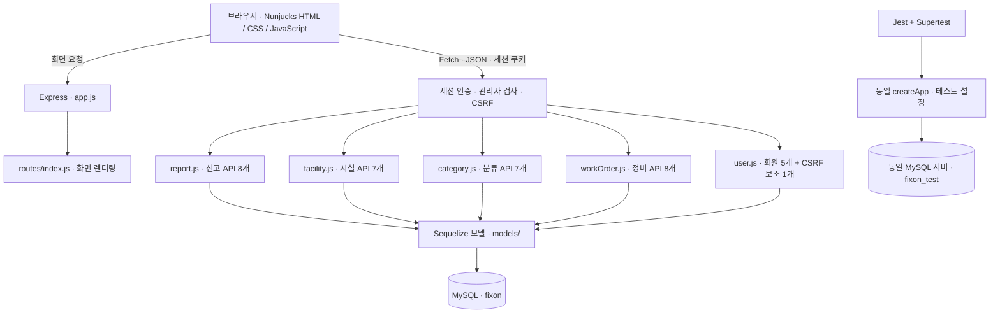

# FixOn 구현 아키텍처

Express와 Nunjucks, Sequelize 모델을 사용하는 수업 기본 구조다. 화면과 API는 한 서버에서 제공한다. 회원 라우터를 제외한 업무 라우터는 4개, 업무 API는 30개다.

수업 예제 대비 추가한 것은 업무 모델·라우터·화면, 세션 로그인, 관리자 권한, CSRF 검증, 입력 검증, 상태 전이, 트랜잭션, 테스트다. app.js에서 서버 시작 부분만 server.js로 분리해 테스트에서 앱을 가져올 수 있게 했다.

테스트 DB는 실제 MySQL DB다. 서비스용 fixon과 이름을 분리해 자동 테스트가 시연 데이터를 바꾸지 않게 한다. SQLite와 가짜 DB를 사용하지 않는다.

라우터별 전체 목록은 [API_SPEC.md](API_SPEC.md), 테이블 관계·상태 규칙은 [ERD.md](ERD.md)를 참고한다.
