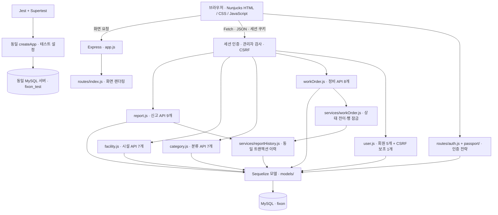

# FixOn 구현 아키텍처

Express와 Nunjucks, Sequelize 모델을 사용하는 수업 기본 구조다. 화면과 API는 한 서버에서 제공한다. 회원 라우터를 제외한 업무 라우터는 4개, 업무 API는 31개다.

수업 예제 대비 추가한 것은 업무 모델·라우터·화면, 세션 로그인, 관리자 권한, CSRF 검증, 입력 검증, 상태 전이, 트랜잭션, 테스트다. 교수님처럼 app.js에서 서버를 실행하고 Express 앱을 내보낸다. require.main 검사로 테스트에서 가져올 때는 포트를 열지 않는다.

테스트 DB는 실제 MySQL DB다. 서비스용 fixon과 이름을 분리해 자동 테스트가 시연 데이터를 바꾸지 않게 한다. 업무·이력·세션 테스트는 실제 MySQL을 사용한다. 소셜 로그인 테스트는 외부 API와 회원 저장소를 모의하여 성공·취소·실패·state 검증을 수행하며 실제 제공자 인증을 대체하지 않는다.

라우터별 전체 목록은 [API_SPEC.md](API_SPEC.md), 테이블 관계·상태 규칙은 [ERD.md](ERD.md)를 참고한다.

## 역할 분리

- app.js가 앱 구성·DB 준비·서버 시작을 담당하고 앱 자체를 내보낸다. 테스트용 createApp도 제공한다.
- models/index.js가 모델의 init을 호출한 뒤 associate를 호출하고, DB와 모델을 내보낸다.
- passport/index.js가 회원 ID 직렬화·역직렬화와 local/kakao/google 전략을 등록한다.
- routes/auth.js가 인증 요청을 받고 각 Router는 교수님처럼 Router 객체를 내보낸다. 테스트용 createRouter로 연결을 분리한다.
- services/workOrder.js는 부모 신고 → 작업 순서의 잠금, 변경과 이력의 원자적 저장, 상태 전이를 담당한다.
- services/reportHistory.js는 기록할 업무 필드만 선택한다. 토큰·비밀번호는 저장하지 않는다.
- public/js/manage-view.js는 공통 폼 도구, manage-forms.js는 기능별 입력 폼,
  manage-tables.js는 목록 표시, manage.js는 조회·이벤트·저장 흐름을 담당한다.
- 담당자 배정은 실제 정비 수행자를 기록하는 기능이다. 일반 회원에게 관리자 작업 권한을 부여하지 않는다.

로그인 성공 시 Passport가 세션 ID를 교체하고 `session.passport.user`에 회원 ID를 저장한다. 이후 Passport 역직렬화가 users에서 공개 회원 필드만 조회한다. 기존 수동 세션은 재로그인이 필요하며 업무 데이터는 유지된다.
