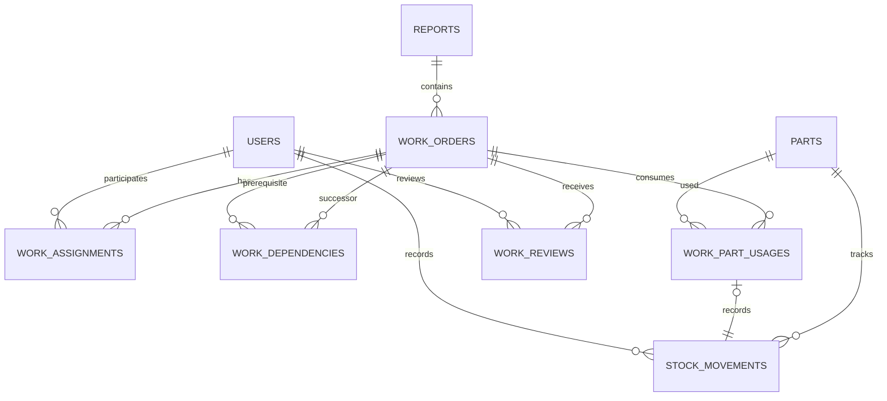
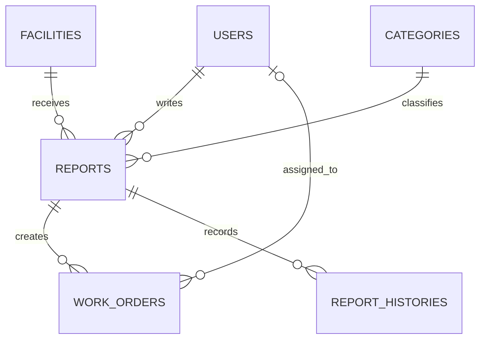

# FixOn 데이터베이스 설계

정비 업무 확장은 기존 API 주소를 사용한다. 신고 상세에서 정비 작업의 배정 인원,
선행 작업 상태, 부품 사용량, 검수자와 검수 기록을 함께 조회한다.

| 기존 경로 | 확장 입력 또는 응답 |
|---|---|
| GET /api/work-orders | 관리자는 전체, 일반 사용자는 배정된 작업만 조회 |
| GET /api/work-orders/summary | 작업 집계와 부품 목록 및 가용 재고 |
| PATCH /api/work-orders/:id | `prerequisiteIds` 배열 또는 `stockReceipt: { code, name, quantity }` |
| PATCH /api/work-orders/:id/assignee | `assigneeId`와 선택적 `supportIds` 배열 |
| PATCH /api/work-orders/:id/status | `SUBMITTED`에 `resolutionNote`와 선택적 `parts: [{ partId, quantity }]`, 검수는 `COMPLETED` 승인 또는 `IN_PROGRESS` 반려와 `comment` |
| GET /api/reports/:id | 기존 신고 정보와 작업별 배정·선행 작업·부품 사용·검수 |

선행 작업은 같은 신고 안에서 지정하고 순환을 거절한다. 선행 작업이 승인돼야 후속
작업을 시작할 수 있다. 부품 사용, 재고 차감, 출고 및 제출 상태는 같은 트랜잭션에서
저장한다. 반려는 실제 사용한 부품의 출고를 취소하지 않는다. 취소되지 않은 작업이
하나 이상 있고 모두 완료되면 신고가 해결 완료된다. 기존 완료 작업은 당시의 완료
상태를 인정하며, 기존 담당자도 자신의 작업에 접근할 수 있다.

배포용 추가 테이블 `sessions`: sid VARCHAR(128) PK, data MEDIUMTEXT NOT NULL, expires DATETIME NOT NULL (인덱스). 서버 간 로그인 세션 공유에 사용하며 업무 라우터·API 개수에는 포함하지 않는다. 로컬은 기존 메모리 세션을 기본으로 유지한다.

MySQL + Sequelize. 모델은 models/에서 정의하며 models/index.js에서 관계를 연결한다. 업무 테이블은 createdAt·updatedAt DATETIME을 가지며, report_histories는 createdAt만 가진다. 업무 테이블의 id는 INTEGER AUTO_INCREMENT 기본 키다.

## 필드

| 테이블 | 필드 | 타입·제약 |
|---|---|---|
| users | id | VARCHAR(100), PK, 로그인 ID |
| users | password | VARCHAR(100), NOT NULL, bcrypt 해시 |
| users | name | VARCHAR(40), NOT NULL |
| users | role | ENUM(USER, ADMIN), NOT NULL, 기본 USER |
| facilities | id | INTEGER, PK, AUTO_INCREMENT |
| facilities | name, building, room | VARCHAR(100), NOT NULL |
| facilities | facilityType | VARCHAR(40), NOT NULL |
| facilities | description | TEXT, NULL 허용 |
| facilities | active | BOOLEAN, NOT NULL, 기본 true |
| categories | id | INTEGER, PK, AUTO_INCREMENT |
| categories | code | VARCHAR(40), NOT NULL, UNIQUE |
| categories | name | VARCHAR(100), NOT NULL |
| categories | description | TEXT, NULL 허용 |
| categories | active | BOOLEAN, NOT NULL, 기본 true |
| reports | id | INTEGER, PK, AUTO_INCREMENT |
| reports | userId | VARCHAR(100), NOT NULL, FK users.id |
| reports | facilityId | INTEGER, NOT NULL, FK facilities.id |
| reports | categoryId | INTEGER, NOT NULL, FK categories.id |
| reports | title | VARCHAR(150), NOT NULL |
| reports | description | TEXT, NOT NULL |
| reports | priority | ENUM(LOW,NORMAL,HIGH,URGENT), NOT NULL, 기본 NORMAL |
| reports | status | ENUM(REPORTED,CONFIRMED,IN_PROGRESS,RESOLVED,REJECTED), NOT NULL, 기본 REPORTED |
| reports | imageUrl | VARCHAR(1000), NULL 허용 |
| work_orders | id | INTEGER, PK, AUTO_INCREMENT |
| work_orders | reportId | INTEGER, NOT NULL, FK reports.id |
| work_orders | assigneeId | VARCHAR(100), NULL 허용, FK users.id |
| work_orders | dueAt | DATETIME, NOT NULL |
| work_orders | status | VARCHAR(20), NOT NULL, 기본 OPEN. 허용 상태에 SUBMITTED 포함 |
| work_orders | resolutionNote | TEXT, NULL 허용, 완료 시 API에서 필수 검증 |
| work_orders | completedAt | DATETIME, NULL 허용 |

시간은 서버와 DB 연결에서 UTC로 저장·전달하고 화면에서는 브라우저 현지 시간으로 표시한다. 화면의 datetime-local 입력은 JavaScript가 ISO UTC 문자열로 변환해 전송한다.

## 참조와 삭제

회원·시설·분류는 여러 신고에 연결된다. 신고에는 여러 정비 작업을 연결할 수 있다. 담당자는 배정 전 NULL이고 한 회원이 여러 작업에 배정될 수 있다.

참조 부모 삭제는 RESTRICT로 막는다. 시설·분류는 신고에서 참조되면 409를 반환하고 비활성화한다. 작업이 연결된 신고는 삭제할 수 없다. 회원 삭제 API는 제공하지 않는다. 수업의 댓글 CASCADE 삭제를 신고 이력에 적용하지 않았다.

## 상태 전이

| 대상·현재 상태 | 허용 다음 상태 | 조건 |
|---|---|---|
| 신고 REPORTED | CONFIRMED, REJECTED | 관리자, 작업 연결 전 |
| 신고 CONFIRMED | REJECTED | 관리자, 작업 연결 전 |
| 작업 생성 | OPEN | 존재하는 REPORTED·CONFIRMED 신고, 중복 없음 |
| 작업 OPEN | ASSIGNED | 유효한 회원 배정 API |
| 작업 ASSIGNED | ASSIGNED | 담당자 변경 API |
| 작업 ASSIGNED | IN_PROGRESS | 배정 인원 또는 관리자, 선행 작업 승인 필요 |
| 작업 IN_PROGRESS | SUBMITTED | 배정 인원 또는 관리자, 처리 결과 필수 |
| 작업 SUBMITTED | COMPLETED, IN_PROGRESS | 관리자 승인 또는 반려, 반려 의견 필수 |
| 작업 OPEN·ASSIGNED·IN_PROGRESS | CANCELLED | 관리자 |
| 작업 CANCELLED | OPEN | 관리자 재개, 담당자·완료 시각 초기화 |
| 작업 COMPLETED | 없음 | 완료 작업 수정·재진행 제한 |

취소되지 않은 작업이 하나 이상 있고 모두 완료되면 신고를 RESOLVED로 변경한다. 진행·검수 대기·완료된 작업이 있고 미완료 작업이 남아 있으면 IN_PROGRESS로 유지한다. 그 외에는 CONFIRMED다. 작업과 충돌하는 신고 직접 상태 변경은 거절한다.

## 트랜잭션

작업 생성·작업 변경·신고 수정·삭제는 부모 신고 행을 먼저 SELECT FOR UPDATE로 잠근다. 작업 변경 시 해당 작업도 잠근다. 동일한 잠금 순서로 동시 요청 간 충돌을 줄인다.  작업 상태와 신고 상태 변경은 하나의 Sequelize 트랜잭션으로 커밋하거나 롤백한다.

서비스용 DB는 fixon, 테스트 DB는 fixon_test이며 같은 MySQL 서버를 사용할 수 있다. 테스트 초기화는 이름 검사 후 fixon_test에서만 실행한다.

## report_histories

| 필드 | 타입·의미 |
|---|---|
| id | INTEGER AUTO_INCREMENT PK |
| reportId | reports.id FK, NOT NULL, 신고 삭제 시 CASCADE |
| workOrderId | INTEGER NULL, 관련 정비 번호 스냅샷 |
| actorId, actorName | VARCHAR(100), VARCHAR(40), 변경 당시 처리자 스냅샷 |
| action | VARCHAR(40), 처리 종류 |
| before, after | JSON, 변경 전후 업무 상태, before는 최초 생성 시 NULL |
| createdAt | DATETIME, 기록 시각 |

(reportId, id) 인덱스를 사용한다. 처리자 이름이 나중에 변경되어도 변경 당시 이름을 보존한다.
기존 기록은 소급 생성하지 않는다. DB를 직접 수정한 내용은 자동 기록하지 않는다.

기존 신고 상세 API는 시설·분류·여러 정비 작업·작업별 담당자를 함께 반환한다. 서버 시작 시 기존 단일 작업 제약은 일반 인덱스로 교체한다. 취소를 제외한 작업이 하나 이상 있고 모두 완료되면 신고가 해결 완료된다.
