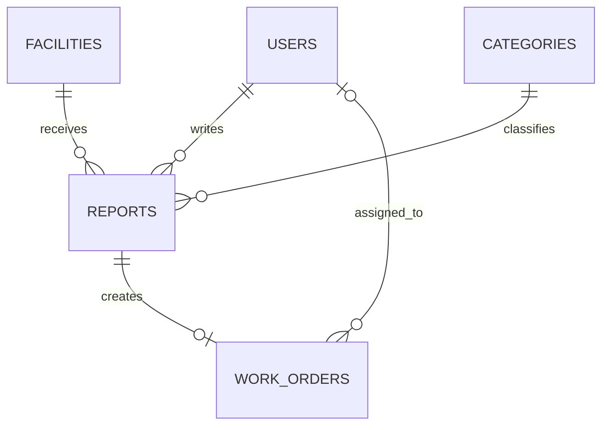

# FixOn 데이터베이스 설계

MySQL + Sequelize. 모델은 models/에서 정의하며 models/index.js에서 관계를 연결한다. 테이블은 모두 createdAt·updatedAt DATETIME을 가진다. 업무 테이블의 id는 INTEGER AUTO_INCREMENT 기본 키다.

## 필드

| 테이블 | 필드 | 타입·제약 |
|---|---|---|
| users | id | VARCHAR(100), PK, 로그인 ID |
| users | password | VARCHAR(100), NOT NULL, bcrypt 해시 |
| users | name | VARCHAR(40), NOT NULL |
| users | role | ENUM(USER, ADMIN), NOT NULL, 기본 USER |
| facilities | id | INTEGER, PK, AUTO_INCREMENT |
| facilities | name, building, room | VARCHAR(100), NOT NULL |
| facilities | facilityType | VARCHAR(40), NOT NULL |
| facilities | description | TEXT, NULL 허용 |
| facilities | active | BOOLEAN, NOT NULL, 기본 true |
| categories | id | INTEGER, PK, AUTO_INCREMENT |
| categories | code | VARCHAR(40), NOT NULL, UNIQUE |
| categories | name | VARCHAR(100), NOT NULL |
| categories | description | TEXT, NULL 허용 |
| categories | active | BOOLEAN, NOT NULL, 기본 true |
| reports | id | INTEGER, PK, AUTO_INCREMENT |
| reports | userId | VARCHAR(100), NOT NULL, FK users.id |
| reports | facilityId | INTEGER, NOT NULL, FK facilities.id |
| reports | categoryId | INTEGER, NOT NULL, FK categories.id |
| reports | title | VARCHAR(150), NOT NULL |
| reports | description | TEXT, NOT NULL |
| reports | priority | ENUM(LOW,NORMAL,HIGH,URGENT), NOT NULL, 기본 NORMAL |
| reports | status | ENUM(REPORTED,CONFIRMED,IN_PROGRESS,RESOLVED,REJECTED), NOT NULL, 기본 REPORTED |
| reports | imageUrl | VARCHAR(1000), NULL 허용 |
| work_orders | id | INTEGER, PK, AUTO_INCREMENT |
| work_orders | reportId | INTEGER, NOT NULL, UNIQUE, FK reports.id |
| work_orders | assigneeId | VARCHAR(100), NULL 허용, FK users.id |
| work_orders | dueAt | DATETIME, NOT NULL |
| work_orders | status | ENUM(OPEN,ASSIGNED,IN_PROGRESS,COMPLETED,CANCELLED), NOT NULL, 기본 OPEN |
| work_orders | resolutionNote | TEXT, NULL 허용, 완료 시 API에서 필수 검증 |
| work_orders | completedAt | DATETIME, NULL 허용 |

시간은 서버와 DB 연결에서 UTC로 저장·전달하고 화면에서는 브라우저 현지 시간으로 표시한다. 화면의 datetime-local 입력은 JavaScript가 ISO UTC 문자열로 변환해 전송한다.

## 참조와 삭제

회원·시설·분류는 여러 신고에 연결된다. 신고에는 정비 작업이 없거나 하나 있으며 reportId UNIQUE로 1:0..1 관계를 보장한다. 담당자는 배정 전 NULL이고 한 회원이 여러 작업에 배정될 수 있다.

참조 부모 삭제는 RESTRICT로 막는다. 시설·분류는 신고에서 참조되면 409를 반환하고 비활성화한다. 작업이 연결된 신고는 삭제할 수 없다. 회원 삭제 API는 제공하지 않는다. 수업의 댓글 CASCADE 삭제를 신고 이력에 적용하지 않았다.

## 상태 전이

| 대상·현재 상태 | 허용 다음 상태 | 조건 |
|---|---|---|
| 신고 REPORTED | CONFIRMED, REJECTED | 관리자, 작업 연결 전 |
| 신고 CONFIRMED | REJECTED | 관리자, 작업 연결 전 |
| 작업 생성 | OPEN | 존재하는 REPORTED·CONFIRMED 신고, 중복 없음 |
| 작업 OPEN | ASSIGNED | 유효한 회원 배정 API |
| 작업 ASSIGNED | ASSIGNED | 담당자 변경 API |
| 작업 ASSIGNED | IN_PROGRESS | 관리자 |
| 작업 IN_PROGRESS | COMPLETED | 관리자, 처리 결과 필수 |
| 작업 OPEN·ASSIGNED·IN_PROGRESS | CANCELLED | 관리자 |
| 작업 CANCELLED | OPEN | 관리자 재개, 담당자·완료 시각 초기화 |
| 작업 COMPLETED | 없음 | 완료 작업 수정·재진행 제한 |

작업 생성·취소·재개 시 신고는 CONFIRMED, 진행 시 IN_PROGRESS, 완료 시 RESOLVED로 동기화한다. 작업과 충돌하는 신고 직접 상태 변경은 거절한다.

## 트랜잭션

작업 생성·작업 변경·신고 수정·삭제는 부모 신고 행을 먼저 SELECT FOR UPDATE로 잠근다. 작업 변경 시 해당 작업도 잠근다. 동일한 잠금 순서로 동시 요청 간 충돌을 줄인다. 작업 생성 시 UNIQUE 제약도 함께 적용한다. 작업 상태와 신고 상태 변경은 하나의 Sequelize 트랜잭션으로 커밋하거나 롤백한다.

서비스용 DB는 fixon, 테스트 DB는 fixon_test이며 같은 MySQL 서버를 사용할 수 있다. 테스트 초기화는 이름 검사 후 fixon_test에서만 실행한다.
